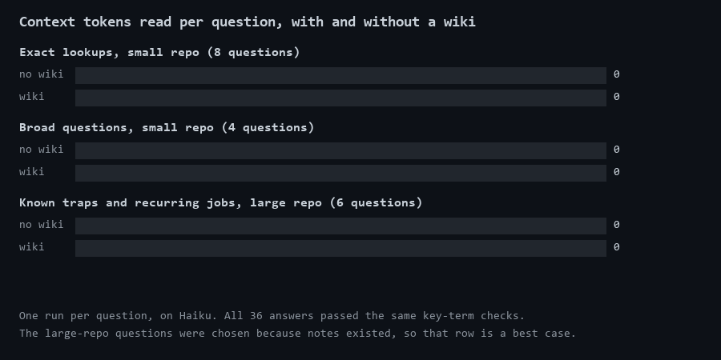

# wikifirst

[English](README.md) | **Italiano**

Una skill per [Claude Code](https://claude.com/claude-code) che fa controllare all'agente ciò che il progetto sa già prima di cercare nel codice, e gli fa scrivere ciò che è stato difficile trovare.



## Il problema

Ogni nuova sessione parte senza sapere nulla del tuo progetto. Se una sessione precedente ha fatto 20 ricerche per capire perché qualcosa si rompe, la successiva paga di nuovo quelle 20 ricerche.

## Cosa fa

Scrivi `/wikifirst` e resta attiva per tutta la sessione.

| Quando | Cosa fa l'agente |
|---|---|
| Ha un nome da cercare | Cerca direttamente nel codice, perché qui una wiki aggiunge solo costo |
| Non sa dove guardare | Legge `docs/wiki/INDEX.md`, poi solo la nota che gli serve |
| La domanda tocca più note | Chiede al subagent `wiki-search`, che gira su Haiku e restituisce solo la risposta |
| Ha capito qualcosa di difficile | Scrive una nota breve, così nessuna sessione dovrà capirlo di nuovo |

Una nota dice dove guardare e cosa aspettarsi, ma vince sempre il codice. Se una nota si rivela sbagliata, l'agente la corregge nello stesso turno.

L'agente scrive una nota solo quando ritrovare la risposta costerebbe più che scriverla: un flusso che attraversa più file, una causa che non stava dove appariva il problema, un valore che sembra sbagliato e non lo è. Non scrive ciò che si trova con una sola ricerca.

## Risultati

Ogni domanda è stata eseguita una volta con le note e una volta senza, su Haiku. Tutte le 36 risposte hanno superato lo stesso controllo automatico sui termini chiave. Questi sono valori medi per domanda.

| Prova | Chiamate agli strumenti | Token di contesto letti | Token in output |
|---|---:|---:|---:|
| Ricerche precise, repo piccola (8 domande) | da 4,2 a 4,8 | da 127.967 a 145.476 **(+14%)** | da 1.478 a 1.696 (+15%) |
| Domande generiche, repo piccola (4 domande) | da 6,5 a 5,2 | da 195.241 a 176.934 **(-9%)** | da 2.687 a 2.266 (-16%) |
| Trappole già note e lavori ricorrenti, repo grande (6 domande) | da 17,8 a 7,2 | da 701.421 a 227.403 **(-68%)** | da 6.827 a 2.741 (-60%) |

La repo piccola è il codice interno di pip 26.1.1 (148 file, 1,1 MB), con 8 note scritte da `document-repo.md`. La repo grande è un progetto privato di un videogioco (circa 165.000 file tracciati, risorse comprese), con note scritte a mano durante mesi di lavoro. I dati delle singole esecuzioni sono in [`benchmark/results.csv`](benchmark/results.csv), senza le domande del progetto privato.

Cosa dimostra:

- **Il risparmio viene da ciò che il codice non dice in fretta.** Sulla repo grande, le note hanno ridotto la ricerca da circa 18 chiamate a circa 7.
- **Una wiki peggiora le ricerche facili.** Quando una ricerca trova subito la risposta, leggere prima indice e nota aggiunge solo costo. La skill dice all'agente di saltare la wiki in quel caso.
- **Documentare una repo piccola non conviene.** Scrivere le 8 note è costato 3,2 milioni di token di contesto e 34.732 token in output su Sonnet. Questa cifra comprende un contesto iniziale ampio, dovuto al progetto in cui girava la prova, quindi un'esecuzione normale ne userebbe meno. Anche così, con il risparmio misurato qui, servirebbero più di 100 domande generiche per recuperarli.

## Limiti

- **La riga della repo grande è il caso migliore.** Quelle domande sono state scelte perché le note esistevano già. Una sessione vera chiede anche cose che le note non coprono.
- **È una prova piccola.** C'è una sola esecuzione per domanda, su un solo modello, e misura agenti di ricerca appena avviati, non intere sessioni di lavoro.
- **Il costo per scrivere le note della repo grande non è contato.** Sono state scritte durante il lavoro normale, quindi nessuno lo ha misurato.
- **Documentare una repo grande in una volta sola non è stato misurato.** Le note della repo grande non sono nate così, quindi il -68% non dice nulla su `document-repo`.
- **Il controllo sui termini chiave è permissivo.** Mostra che una risposta nomina le cose giuste, non che sia completa. Alcune risposte senza note hanno mancato una trappola pratica, come l'ordine in cui vanno creati due file, ma hanno superato il controllo lo stesso.
- **Le note possono ingannare.** Una nota superata costa più di nessuna nota. `check_wiki.py` trova le note i cui file di origine sono cambiati, ma non può dire se una nota è ancora giusta. In una prova, un agente ha segnalato come sbagliata una nota che riportava un valore passato, quindi controlla una contraddizione segnalata prima di correggere qualcosa.
- **`document-repo.bat` non ha ancora fatto un'esecuzione completa.** La richiesta di consenso, i rifiuti, il tetto di spesa e gli argomenti sono stati provati con un sostituto al posto di Claude. Le istruzioni di `document-repo.md` sono state eseguite tramite un subagent, non tramite il `.bat`.

## Installazione

Dalla cartella principale del tuo progetto:

```bash
git clone --depth 1 https://github.com/Nduli96/wikifirst .claude/skills/wikifirst
rm -rf .claude/skills/wikifirst/.git
mkdir -p .claude/agents
cp .claude/skills/wikifirst/agents/wiki-search.md .claude/agents/
```

Apri una nuova sessione, così Claude Code carica il subagent, poi scrivi `/wikifirst`.

## Iniziare una wiki

Non serve documentare nulla in anticipo. La wiki può crescere dalle note che l'agente scrive mentre lavora, e sono proprio quelle che hanno dato il risparmio qui sopra.

Se vuoi una prima passata su una repo grande, `document-repo.bat` la fa su Windows. Lancialo dall'interno della repo, con un tetto di spesa in dollari USA (il valore predefinito è 5):

```bash
.claude\skills\wikifirst\document-repo.bat 5
```

Mostra la repo, il numero di file e il tetto, spiega cosa succederà e non fa nulla finché non scrivi `YES`. Non c'è nessuna opzione per saltare questo passaggio. Lancialo solo su una repo tua o che hai il permesso di documentare.

- **Dove finisce il tuo codice:** Claude Code legge i file tracciati e il loro contenuto va al fornitore del modello, come in qualsiasi sessione.
- **Cosa scrive:** solo `docs/wiki/`, imposto dai permessi degli strumenti che passa a Claude Code. Non fa commit e ti avvisa se è cambiato qualche file fuori da quella cartella.
- **Se raggiunge il tetto:** le note scritte fin lì restano. Rilancialo per continuare da dove si è fermato.
- **Dati segreti:** i file che sembrano contenerne vengono bloccati in base al nome, e qualcuno può sfuggire. Leggi le note prima di pubblicarle.

Se `claude` non è nel PATH, imposta `CLAUDE_CMD` con il percorso completo di `claude.exe`. Per ora non c'è una versione per macOS o Linux.

## Trovare le note superate

`check_wiki.py` confronta ogni nota con i file che descrive usando solo git, quindi non consuma token. Lancialo dall'interno della repo:

```bash
python .claude/skills/wikifirst/check_wiki.py
```

Segnala i file di origine cambiati dall'ultimo controllo della nota, i file che non esistono più e le note assenti dall'indice. Richiede Python 3.7+ e git.

## Cosa c'è in questa cartella

| File | A cosa serve |
|---|---|
| `SKILL.md` | Le regole che l'agente segue |
| `agents/wiki-search.md` | Il subagent di ricerca, in sola lettura |
| `document-repo.bat` | Chiede il consenso, poi avvia la prima passata |
| `document-repo.md` | Le istruzioni per quella prima passata |
| `check_wiki.py` | Segnala le note superate |

## Licenza

MIT. Vedi [LICENSE](LICENSE).
