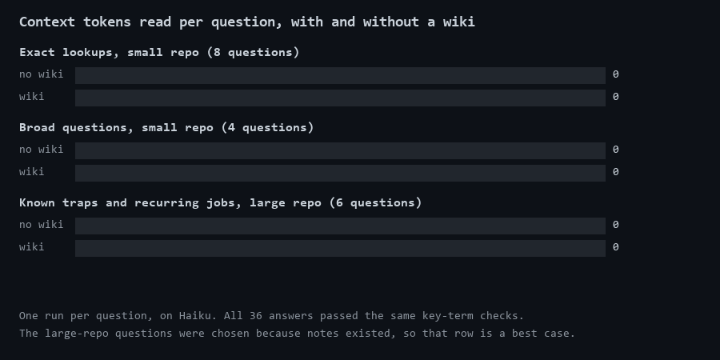

# wikifirst

A [Claude Code](https://claude.com/claude-code) skill that makes the agent check what the project already knows before searching its code, and write down what was hard to find.



## The problem

Every new session starts knowing nothing about your project. If a past session spent 20 searches finding out why something breaks, the next one pays for those 20 searches again.

## What it does

Type `/wikifirst` and it stays on for the session.

| When | What the agent does |
|---|---|
| It has a name it can search for | Searches the code directly, because a wiki only adds cost here |
| It does not know where to look | Reads `docs/wiki/INDEX.md`, then only the note it needs |
| The question spans several notes | Asks the `wiki-search` subagent, which runs on Haiku and returns only the answer |
| It worked out something hard | Writes a short note, so no session has to work it out again |

A note says where to look and what to expect, but the code always wins. If a note turns out to be wrong, the agent fixes it in the same turn.

The agent only writes a note when finding the answer again would cost more than writing it: a flow across several files, a cause that was not where the problem appeared, a value that looks wrong and isn't. It doesn't write what one search would find.

## Results

Each question ran once with notes and once without, on Haiku. All 36 answers passed the same automated check for key terms. These are averages per question.

| Test | Tool calls | Context tokens read | Output tokens |
|---|---:|---:|---:|
| Exact lookups, small repo (8 questions) | 4.2 → 4.8 | 127,967 → 145,476 **(+14%)** | 1,478 → 1,696 (+15%) |
| Broad questions, small repo (4 questions) | 6.5 → 5.2 | 195,241 → 176,934 **(-9%)** | 2,687 → 2,266 (-16%) |
| Known traps and recurring jobs, large repo (6 questions) | 17.8 → 7.2 | 701,421 → 227,403 **(-68%)** | 6,827 → 2,741 (-60%) |

The small repo is the internal code of pip 26.1.1 (148 files, 1.1 MB), with 8 notes written by `document-repo.md`. The large repo is a private game project (about 165,000 tracked files, including assets), with notes written by hand during months of work. Per-run data is in [`benchmark/results.csv`](benchmark/results.csv). The private project's questions are left out.

What this shows:

- **The saving comes from what the code doesn't tell you quickly.** On the large repo, the notes cut the search from about 18 tool calls to about 7.
- **A wiki makes easy lookups worse.** When a search finds the answer straight away, reading an index and a note first only adds cost. The skill tells the agent to skip the wiki in that case.
- **Documenting a small repo doesn't pay.** Building the 8 notes took 3.2 million context tokens and 34,732 output tokens on Sonnet. That figure includes a large start context from the project the test ran in, so a normal run would use less. Even so, at the saving measured here, you would need more than 100 broad questions to get it back.

## Limits

- **The large-repo row is a best case.** Those questions were picked because notes for them already existed. A real session also asks things the notes don't cover.
- **This is a small test.** It has one run per question, on one model, and it measures fresh search agents rather than whole working sessions.
- **The cost of writing the large repo's notes isn't counted.** They were written during normal work, so nobody measured it.
- **Documenting a large repo in one go was not measured.** The large-repo notes were not built that way, so the -68% says nothing about `document-repo`.
- **The check for key terms is lenient.** It shows that an answer names the right things, not that it is complete. Some answers without notes missed a practical trap, such as the order in which two files have to be created, but still passed.
- **Notes can mislead.** A stale note costs more than no note. `check_wiki.py` finds notes whose sources have changed, but it can't tell whether a note is still right. In one test, an agent reported a note as wrong because the note recorded a past value, so check a reported contradiction before you correct anything.
- **`document-repo.bat` has not done a full run.** Its consent prompt, refusals, spending limit and arguments were tested with a stand-in for Claude. The instructions in `document-repo.md` were run through a subagent, not through the `.bat`.

## Install

From the root of your project:

```bash
git clone --depth 1 https://github.com/Nduli96/wikifirst .claude/skills/wikifirst
rm -rf .claude/skills/wikifirst/.git
mkdir -p .claude/agents
cp .claude/skills/wikifirst/agents/wiki-search.md .claude/agents/
```

Start a new session, so that Claude Code loads the subagent, then type `/wikifirst`.

## Starting a wiki

You don't need to document anything up front. The wiki can grow from the notes the agent writes as it works, and those are the kind of notes that gave the saving above.

If you want a first pass over a large repository, `document-repo.bat` does one on Windows. Run it from inside the repository, with a spending limit in US dollars (the default is 5):

```bash
.claude\skills\wikifirst\document-repo.bat 5
```

It shows the repository, the number of files and the limit, explains what will happen, and does nothing unless you type `YES`. There is no flag to skip this. Only run it on a repository you own or have permission to document.

- **Where your code goes:** Claude Code reads your tracked files, and their content goes to the model provider, as in any session.
- **What it writes:** only `docs/wiki/`, enforced by the tool permissions it passes to Claude Code. It commits nothing, and warns you if any file outside that folder changed.
- **If it hits the limit:** the notes written so far are kept. Run it again to continue from where it stopped.
- **Secrets:** files that look like secrets are blocked by name, which can miss some. Read the notes before you publish them.

If `claude` isn't on your PATH, set `CLAUDE_CMD` to the full path of `claude.exe`. There is no version for macOS or Linux yet.

## Finding stale notes

`check_wiki.py` compares each note with the files it describes, using git only, so it costs no tokens. Run it from inside the repository:

```bash
python .claude/skills/wikifirst/check_wiki.py
```

It reports source files that changed since the note was last checked, files that no longer exist, and notes missing from the index. It needs Python 3.7+ and git.

## What's in this folder

| File | Purpose |
|---|---|
| `SKILL.md` | The rules the agent follows |
| `agents/wiki-search.md` | The read-only search subagent |
| `document-repo.bat` | Asks for consent, then runs the first pass |
| `document-repo.md` | The instructions for that first pass |
| `check_wiki.py` | Reports stale notes |

## License

MIT. See [LICENSE](LICENSE).
